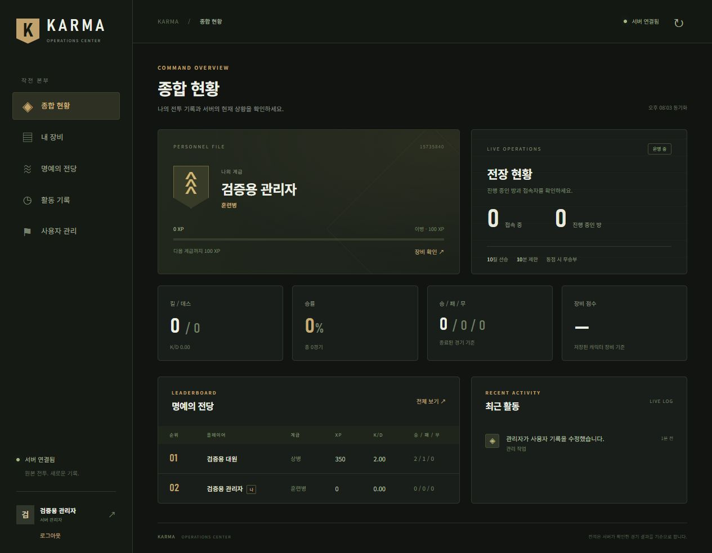

# Karma LAN 클라이언트

Karma290 원본 게임에 Windows 실행기, 입력 호환성 수정, 최대 8인 LAN 대전과 중앙 서버 계정을 연결한 실험 버전입니다.

v0.7.0은 무기별 공격 기법과 누적 숙련 승급을 추가합니다. **서명 키 교체로 기존 사용자도 한 번 직접 재설치해야 합니다.** 기존 계정·전적은 보존됩니다. [변경 사항](docs/release-v0.7.0.md).

v0.7.1: Enter 채팅 전달 확인, 같은 방 대기실 복귀, 게임 이름 변경, 원격 마우스 설정, 맵별 기법 및 관리자 해제형 실적 작업 탐지. [변경 사항](docs/release-v0.7.1.md).

## 설치와 실행

1. [Releases](https://github.com/mrgrit/karma/releases)의 **Karma-LAN-Setup-v0.7.6.exe**를 받습니다.
2. 설치 파일을 실행하고 **설치**를 누릅니다. 게임과 런타임이 사용자 폴더에 함께 설치되며 바탕화면과 시작 메뉴에 바로가기가 생깁니다.
3. 바탕화면의 **카르마 LAN**을 실행합니다. REA나 Node를 따로 설치할 필요는 없습니다. 업데이트 설치 시 기존 개인 설정과 로그인 정보는 유지됩니다. 포터블 사용자는 ZIP 전체를 압축 해제하세요.
4. `로그인/계정`에서 회원가입 또는 로그인합니다. 현재 이메일 인증은 생략하며, 가입 신청 후 관리자가 승인해야 로그인할 수 있습니다.
5. 캐릭터를 고르고 `장비·계급`에서 초기 무기를 선택합니다.
6. 방장은 `서버 방 만들기 (2~8인)`에서 방 이름과 1:1, 4:4 팀전, 개인 데스매치 및 인원 수를 정합니다. 나머지는 `서버 참가 (2~8인)`에서 **개설된 방 목록**의 방 이름·방장·맵·방식·인원·상태를 확인하고 방을 선택해 참가합니다. 목록은 5초마다 갱신되며 맵은 방장이 정한 것으로 자동 적용됩니다. 서버 주소는 `192.168.12.100`, 게임 포트는 `29020`입니다. 입장하면 먼저 **준비 중**으로 등록됩니다. 대기실의 **장비 설정**으로 장비를 정하고 각자 **준비 완료**를 누르세요. 현재 참가자가 모두 준비해야 방장의 **대전 시작 →**이 활성화됩니다. 장비 설정을 다시 열면 준비가 해제되며, 저장하거나 취소한 뒤 준비 완료를 다시 눌러야 합니다. 두 명부터 시작할 수 있으며 팀전은 2·4·6·8명일 때 시작됩니다. 시작 전에 방장이 나가면 다음 참가자가 방장을 넘겨받습니다. 각 PC는 서로 다른 계정으로 로그인하세요.

실행 파일 하나만 복사하면 동작하지 않습니다. 압축 해제한 Karma 폴더 전체를 옮기세요. `App_Executables`의 EXE를 직접 실행하면 호환성 수정이 적용되지 않습니다.

v0.6.0은 실행 시 공식 파일을 확인하고 변경·손상된 파일을 자동 업데이트합니다. v0.5.2 이전 사용자는 이 설치본을 최초 한 번 설치하세요. 확인하려면 학과 LAN 서버 연결이 필요합니다. [v0.6.0 변경 내용](docs/release-v0.6.0.md).

v0.6.3은 실행 후 첫 계정 접속 때 **원본 메뉴 음악을 한 번만** 재생합니다. 약 1분 17초 뒤 끝나며, 전적 새로고침·재접속·대기실 복귀에는 반복하지 않습니다. **음악 끄기**, 게임 시작, 로그아웃, 실행기 종료 시 멈춥니다. 기존 사용자는 실행기를 닫고 다시 열면 자동 업데이트됩니다. [v0.6.3 변경 내용](docs/release-v0.6.3.md).

v0.6.2는 **최종 결과 화면·퇴장 버튼**, **방별 목표 킬/승수·제한 시간**, **Shift Point 갱신**, **대기실·게임 전체/팀 채팅**을 추가합니다. [v0.6.2 변경 내용](docs/release-v0.6.2.md).

v0.6.1은 시작 직후 잘못된 Esc 상태 때문에 대전이 종료되던 문제를 수정하고 **Esc 종료 확인창**을 추가합니다. v0.6.0 사용자는 실행기를 완전히 닫고 다시 열면 자동 업데이트됩니다. [v0.6.1 변경 내용](docs/release-v0.6.1.md).

v0.5.2는 **진급 누적 경험치 조건을 10배**로 조정하고, 게임 HUD·Shift 전적표의 닉네임과 높은 Windows 배율에서 겹치는 도움말 글자를 수정합니다. 기존 경험치·전적·로그인·코인은 유지됩니다. [v0.5.2 변경 내용](docs/release-v0.5.2.md).

## 현재 게임 규칙

- 원본 캐릭터·무기와 **Mass of Winter · Factory · Rescue** 전장에서 최대 8명이 대전합니다.
- **팀전 (최대 4:4):** 참가 순서대로 RED/BLUE에 번갈아 배정됩니다. 양 팀은 맵 양끝에서 등장합니다. 전사자는 라운드가 끝날 때까지 기다리며, 한 팀 전멸 후 5초 준비 시간을 거쳐 모두 함께 부활합니다. 아군 피해는 없습니다. 라운드 제한 3분, 5라운드 선승, 전체 제한 10분입니다. 라운드 시간 초과 시 생존자가 많은 팀이 승리하고 같으면 무승부입니다.
- **개인 데스매치:** 방장이 정원을 2~8명으로 정하며, 빈자리가 있으면 시작 후에도 참가할 수 있습니다. 경기 중 한 명만 남아도 방은 유지됩니다. 중간 참가자는 현재 점수·캐릭터·남은 바닥 무기를 받고 합류하며 같은 경기 재접속에는 이용료를 다시 내지 않습니다.  첫 등장은 방마다 섞인 서로 다른 위치이며 전사 후 10초 뒤 랜덤 위치에서 부활합니다. 이전 부활 위치를 피하고, 가능한 경우 살아 있는 상대와 거리를 둡니다.
- **1:1:** 기존 두 명 대전이며 전사 후 약 4.5초 뒤 부활합니다. 10초 규칙으로 둘이 하려면 개인 데스매치에서 2명을 선택하세요.
- 캐릭터를 돌격·저격·중화기 병과로 나누고 계급에 따라 해금합니다. 초기 7개 슬롯은 병과와 계급 예산 안에서 선택합니다. XP 6,000 이상의 중화기 병과는 쌍포와 선택적 경량 자동소총 조합을 사용할 수 있습니다. [병과·계급·쌍포 규칙](CLASS_BALANCE.md)을 참고하세요.
- 경험치 0 / 1,000 / 3,000 / 6,000 / 10,000과 무기별 누적 숙련 조건을 함께 만족하면 계급이 올라가며 장비 예산 보너스는 0 / 100 / 200 / 300 / 400입니다. 처치 25 XP, 확인된 사망 5 XP를 기록합니다.
- 사망 시 들고 있던 무기가 바닥에 남습니다. 가까이 가면 화면 오른쪽 아래에 이름·탄약을 한 줄로 표시합니다. **G로 현재 총을 버리고 E로 바닥 무기를 줍습니다.** 자동 획득이나 자동 교체는 하지 않습니다. 빈 슬롯과 계급·병과별 인벤토리 점수 한도를 모두 만족해야 하며, 초과하면 먼저 소지 무기를 버려야 합니다. 버리거나 사망할 때의 탄창·예비탄 수량을 그대로 보존합니다. 같은 무기를 중복 소지하거나 칼을 버릴 수는 없습니다.
- 1:1과 개인전은 10킬 또는 10분에 경기가 끝납니다. 동점은 무승부이며, 시작 후 이탈하면 기권패로 기록합니다. 개인전은 1명 이상 남으면 계속되고, 팀전은 양쪽에 참가자가 남아 있으면 계속됩니다.
- W/A/S/D 이동, 마우스 조준, 왼쪽 클릭 사격, R 재장전, 숫자 1~7 무기 변경, G 현재 총 버리기, E 가까운 무기 줍기.
- F10은 자기 입력과 마우스 점유를 해제하는 메뉴입니다. LAN에서는 상대와 경기 시간이 계속 진행됩니다. Esc는 종료 확인창을 엽니다. **계속하기·Esc·F10·창 닫기**는 게임으로 돌아가며, **종료**를 선택해야 대전을 종료합니다. 기본 Enter 동작도 계속하기입니다. F10 메뉴의 게임 종료 버튼도 먼저 확인을 묻습니다.

로컬 맵·사격 연습·AI 1명 시험판도 실행기에 남아 있습니다. 일반 계정은 검증된 세 전장만 표시하고, 관리자는 원본 로컬 맵도 확인할 수 있습니다. 8인 원본 게임 프로세스 검사는 한 PC에서, 물리 PC 간 대전은 두 PC로 확인했습니다. 8대의 실제 PC 및 장시간 연속 대전은 아직 확인하지 않았습니다. 인터넷 매칭은 지원하지 않습니다.

## 학과 코인

중앙 서버 대전은 시작할 때 참가자마다 **1 KARMA**가 차감됩니다. 대기실과 로컬 연습은 무료입니다. 일반 계정은 최초 지급 때 공동 금고에서 **100 KARMA를 한 번** 받습니다. 이미 체험 코인을 받은 계정에는 추가 지급하지 않습니다. 관리자 초기 배분과 기존 잔액은 유지됩니다. 시작 전 실패 또는 참가자 변경 시 이용료가 반환됩니다. 경기가 시작된 뒤 자진 종료하면 이용료는 반환되지 않습니다.

첫 화면·게임 화면 오른쪽 위·F10 메뉴에 보유 코인을 표시합니다. 게임 중에는 20초마다 서버 잔액을 조회하며, 다른 창이나 메뉴로 이동하면 게임의 코인 표시창은 숨깁니다. 표시창은 키보드와 마우스 입력을 받지 않습니다. **지갑 · 거래소 ↗**에서 활동 보상, 양도, 사설 코인 발행·지정가 거래를 이용합니다. 거래소 주소는 **https://exchange.ycdc.internal**이며 학과 DNS에서 `192.168.12.200`으로 해석되어야 합니다. DNS가 없는 PC는 관리자에게 hosts 등록을 요청하세요. 설치기는 OS 인증서 신뢰 설정을 바꾸지 않습니다.

## 계정과 대시보드

실행기 첫 화면 상단의 **내 전적**에서 본인 이름·계급·XP, 누적 승/패/무, 킬/데스, K/D와 승률을 바로 확인합니다. 방에 들어갈 필요가 없습니다. 실행기를 열 때, 로그인 후, 대전 종료 후 서버 기록을 갱신하며 오른쪽 위 **전적 새로고침**으로도 갱신할 수 있습니다. 승패는 종료된 경기 기준입니다. 서버에 연결되지 않으면 저장된 기록임을 표시하고, 로그아웃하거나 세션이 만료되면 로그인 안내를 표시합니다.

[LAN 대시보드](https://192.168.12.100:29021)에서 본인 계급·장비·승패·킬데스, 리더보드와 최근 활동을 봅니다. 관리자는 사용자 목록에서 경험치·전적·장비·사용 중지 상태를 관리합니다.

아래는 별도 검증 서버의 테스트 계정으로 확인한 화면입니다. 실제 사용자의 전적이 아닙니다.



클라이언트는 배포된 공개 인증서 `server-ca.pem`으로 서버를 검증합니다. 서버 개인키와 사용자 비밀번호는 배포 파일에 없습니다. 브라우저는 내부 서버의 자체 발급 인증서를 별도로 확인할 수 있으며, 경고가 표시되면 서버 주소와 인증서를 사용자가 확인해야 합니다.

로그인 토큰은 Windows 사용자별 `%LOCALAPPDATA%/KarmaLAN/servers`에 저장되며 배포본에는 포함되지 않습니다. 실행기 `로그인/계정`에서 로그아웃할 수 있습니다. 가입 이메일 인증은 현재 꺼져 있으며 추후 SMTP 설정으로 켤 수 있습니다.

서버 코드와 운영 방법: [mrgrit/karma_server](https://github.com/mrgrit/karma_server).

## 소스와 빌드

Git 저장소에는 실행기 EXE, C#·JavaScript 코드, 카탈로그, 네이티브 어댑터 생성 소스와 테스트가 있습니다. 전체 게임 리소스와 Node/Frida 런타임은 Release ZIP에 포함됩니다. Git clone만으로는 게임을 실행할 수 없습니다.

```powershell
# Windows .NET Framework C# 컴파일러 사용
.\build.ps1

# Node.js 20 이상: 게임 실행 없이 코드·TCP·입력 상태 검사
npm test

# 네이티브 LAN 어댑터 다시 생성 (Python 3)
python tools/build_native.py
```

`client/Launcher`가 실제 배포 코드, `native`가 LAN 네이티브 어댑터 원본, `tests`가 테스트입니다. `build.ps1 -GameRoot C:\Games\Karma`로 압축 해제한 게임 폴더의 실행기와 코드만 갱신할 수 있습니다.

8개 원본 게임을 사용하는 선택 검사는 Windows에서 실행합니다. 게임 화면과 입력 장치를 격리한 테스트 프로세스를 사용하고 임시 계정/서버만 생성합니다. 다른 검사를 동시에 실행하지 마세요.

```powershell
$env:KARMA_GAME_ROOT = 'C:\Games\Karma'
$env:KARMA_SERVER_ROOT = 'C:\src\karma_server'
node tests/native_multiplayer_test.mjs
node tests/native_multiplayer_test.mjs --tdm
```

검증 범위는 [VALIDATION.md](VALIDATION.md), 포함 런타임 고지는 [THIRD_PARTY_NOTICES.txt](THIRD_PARTY_NOTICES.txt)를 참고하세요. 게임 리소스와 제3자 구성 요소의 권리는 각 권리자에게 있습니다.
